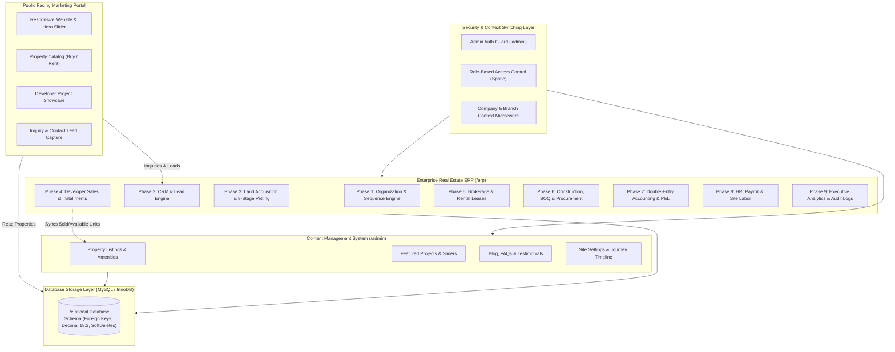
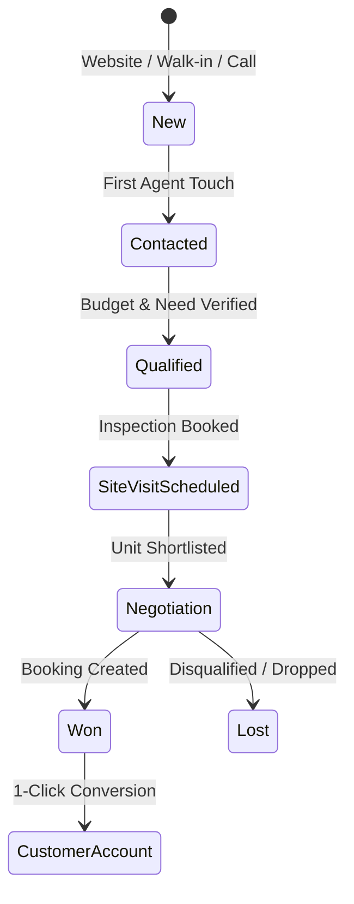

# Enterprise Real Estate ERP & Public CMS Platform
## Complete Master System Feature Documentation & Architecture Manual

**Project Name:** Aurelia Estates Enterprise Real Estate ERP & CMS  
**Framework Version:** Laravel 12.x (PHP 8.2+)  
**Database:** MySQL 8.0+ / MariaDB 10.4+ (InnoDB Engine)  
**Security & Access Control:** Spatie Laravel-Permission (`admin` guard)  
**Testing Framework:** Pest PHP 3.x / PHPUnit 11 (93 Tests Passing, 594 Assertions)  
**Currency & Precision:** Bangladesh Taka (BDT `৳`), Fixed-point Decimal (18, 2)  

---

## Table of Contents
1. [Executive Overview & Architecture](#1-executive-overview--architecture)
2. [Multi-Company & Organization Foundation (Phase 1)](#2-multi-company--organization-foundation-phase-1)
3. [CRM & Omnichannel Lead Generation Engine (Phase 2)](#3-crm--omnichannel-lead-generation-engine-phase-2)
4. [Land Acquisition, Joint Venture (JV) & Legal Vetting (Phase 3)](#4-land-acquisition-joint-venture-jv--legal-vetting-phase-3)
5. [Developer Projects, Inventory Matrix & Sales Bookings (Phase 4)](#5-developer-projects-inventory-matrix--sales-bookings-phase-4)
6. [Agency Brokerage, Resale & Rental Operations (Phase 5)](#6-agency-brokerage-resale--rental-operations-phase-5)
7. [Construction Management, BOQ & Procurement (Phase 6)](#7-construction-management-boq--procurement-phase-6)
8. [Double-Entry Financial Accounting Engine (Phase 7)](#8-double-entry-financial-accounting-engine-phase-7)
9. [Human Resources, Employee Payroll & Daily Site Labor (Phase 8)](#9-human-resources-employee-payroll--daily-site-labor-phase-8)
10. [Unified Enterprise Executive Dashboard (Phase 9)](#10-unified-enterprise-executive-dashboard-phase-9)
11. [Public Real Estate Website & CMS Control Panel](#11-public-real-estate-website--cms-control-panel)
12. [Role-Based Access Control (RBAC) & Security Architecture](#12-role-based-access-control-rbac--security-architecture)
13. [Complete System Route Catalog](#13-complete-system-route-catalog)
14. [Testing Suite & Quality Assurance Verification](#14-testing-suite--quality-assurance-verification)
15. [Deployment, Configuration & Operations Guide](#15-deployment-configuration--operations-guide)

---

## 1. Executive Overview & Architecture

### 1.1 Platform Purpose
The Aurelia Estates platform is an enterprise-grade dual-tier real estate system designed specifically for the real estate and property development market in Bangladesh. It bridges the gap between public-facing marketing/sales portals and internal back-office enterprise resource planning (ERP).



### 1.2 Technology Architecture
- **Backend Core:** Laravel 12.x running PHP 8.2+ with strict typing and PSR-12 code style standards.
- **Database Engine:** MySQL 8.0+ / MariaDB with InnoDB engine, enforcing foreign key integrity, atomic transactions (`DB::transaction`), and concurrency row locking (`lockForUpdate`).
- **Accounting Precision:** Fixed-point calculation with 2 decimal precision (`DECIMAL(18, 2)`), preventing floating-point calculation drift for millions of BDT transactions.
- **Audit Trails:** Immutable audit logging storing previous and new state JSON snapshots, actor IDs, IP addresses, and request identifiers.
- **Frontend Technologies:** Blade Template Engine, Bootstrap 5.3, Bootstrap Icons, FontAwesome 6, Chart.js, Vite build pipeline.
- **Test-Driven Rigor:** Pest PHP 3.x and PHPUnit 11 with 93 automated tests verifying all business rules, edge cases, and CRUD lifecycles.

---

## 2. Multi-Company & Organization Foundation (Phase 1)

### 2.1 Multi-Company Entity Management
- **Legal Entity Setup:** Register multiple corporate entities under a single holding group.
- **Data Attributes:** Legal Name, Trade Name, Company Code (e.g., `AURELIA`), Business Identification Number (BIN), Taxpayer Identification Number (TIN), Base Currency (`BDT`), Fiscal Year Start Month (`July`), Timezone (`Asia/Dhaka`), and Corporate Logo.
- **Safety Guards:** Companies with active branches cannot be deleted; business rules enforce cleanup before removal.

### 2.2 Corporate Branch Network
- **Branch Hierarchy:** Designate one **Head Office** per company and unlimited regional/sales branches (e.g., *Dhaka HQ*, *Chattogram Regional Branch*, *Sylhet Zindabazar Branch*, *Barishal Operations*).
- **Manager Assignment:** Assign administrative users as Branch Managers with operational oversight.
- **Active Workspace Context Switcher:** Administrators can instantly switch active company and branch context from the navigation bar. The system stores `erp_active_company_id` and `erp_active_branch_id` in the session, automatically scoping queries across projects, leads, journals, and procurements.
- **Safety Guards:** Head Office branches cannot be deleted; active transactional dependencies are protected.

### 2.3 Departments, Designations & Cost Centers
- **Department Taxonomy:** Create functional divisions (*Engineering & Construction*, *Sales & Marketing*, *Accounts & Finance*, *Land Acquisition*, *Human Resources*, *Customer Care*).
- **Designation & Pay Grades:** Hierarchical job roles (*Project Director*, *Chief Engineer*, *Senior Structural Inspector*, *Sales Executive*, *Site Supervisor*) with Grade associations.
- **Parent-Child Cost Centers:** Attribution centers for project-specific and departmental overhead expenses (e.g., `CC-AUDIT`, `CC-CORP-ADMIN`, `CC-PRJ-BANANI`).

### 2.4 Fiscal Year Administration
- **Fiscal Calendar Control:** Configure financial accounting periods (e.g., *FY 2025-2026*, *FY 2026-2027*) with Start and End dates.
- **Current Fiscal Period Flag:** Exactly one active fiscal year is flagged current per company.
- **Period Close Protection:** When a fiscal year is closed (`is_closed = true`), no journal vouchers or retroactive accounting adjustments can be posted into that date range.

### 2.5 Atomic Document Sequence Engine (`DocumentSequenceService`)
Generates standardized, collision-free transaction numbers using database row locking:
- `lead`: `LD-2026-0001`
- `customer`: `CUST-0001`
- `land_parcel`: `LP-2026-0001`
- `project`: `PRJ-0001`
- `booking`: `BK-2026-0001`
- `listing`: `LST-2026-0001`
- `vendor`: `VND-0001`
- `requisition`: `REQ-2026-0001`
- `po`: `PO-2026-0001`
- `grn`: `GRN-2026-0001`
- `journal`: `JV-2026-0001`
- `payroll`: `PR-2026-0001`

### 2.6 Immutable Audit Trail (`AuditLogService`)
Every critical creation, modification, status transition, and cancellation automatically creates an audit record capturing:
- `actor_type` & `actor_id` (Admin user)
- `company_id` & `branch_id`
- `action` (e.g., `sales.booking_created`, `acc.journal_posted`, `hr.payroll_disbursed`)
- `subject_type` & `subject_id` (Target model)
- `before_json` & `after_json` (State diff)
- `ip_address`, `user_agent`, `request_id`, `created_at`

---

## 3. CRM & Omnichannel Lead Generation Engine (Phase 2)

### 3.1 Lead Capture & Omnichannel Ingestion
- **Intake Channels:** Website inquiries, Landing page forms, Social media campaigns, Direct phone calls, Walk-ins, Broker referrals.
- **Submissions Auto-Ingestion:** The CRM integrates with the public website `submissions` table. Administrators can click **Import Web Submissions** to ingest new website inquiries into CRM leads with duplicate phone checking.

### 3.2 Lead Lifecycle & Pipeline Progression


### 3.3 Dynamic Lead Scoring Algorithm
Each lead is evaluated dynamically (`0 to 100` score points):
- **Budget Matching:** Specified min/max budget (+20 pts).
- **Verified Phone & Email:** Valid contact channels (+15 pts).
- **Project Specific Interest:** Linked to an active developer project (+20 pts).
- **Completed Site Visit:** Verified property inspection (+25 pts).
- **Recent Engagement:** Follow-up scheduled within 7 days (+20 pts).

### 3.4 Agent Assignment & Round-Robin Routing
- Leads can be assigned manually or automatically routed to the next available sales executive in the branch using round-robin distribution.

### 3.5 Site Visit Management
- Schedule site tours with Date, Time, Assigned Agent, Transportation Notes, and Client Feedback logging (`scheduled`, `completed`, `cancelled`, `no_show`).

### 3.6 One-Click Customer Account Conversion
- Once a lead agrees to buy, administrators click **Convert to Customer**.
- Instantly creates a permanent `CrmCustomer` record (`CUST-xxxx`), carrying forward contact info, NID number, TIN, present/permanent address, and nominee specifications.

---

## 4. Land Acquisition, Joint Venture (JV) & Legal Vetting (Phase 3)

### 4.1 Land Bank Registry
- **Location Specifications:** District, Thana, Mouza, JL Number, CS Dag, SA Dag, RS Dag, City Survey (BS) Dag, Khatian numbers.
- **Measurement Precision:** Land area tracked in both **Katha** and **Decimal** (with automatic conversion $1 \text{ Katha} \approx 1.65 \text{ Decimal}$).
- **Acquisition Models:** Outright purchase vs. Landowner Joint Venture (JV).

### 4.2 Landowner Joint Venture (JV) Matrix
- **Multiple Landowner Register:** Supports complex family ownership where multiple owners hold fractional shares in a single plot.
- **Share Allocation:** Ratio tracking (e.g., Owner A: 40%, Owner B: 35%, Owner C: 25%).
- **Developer vs Landowner Ratio:** Standard Bangladesh sharing formulas (e.g., 50:50, 60:40).
- **Signing Money Tracking:** Total committed signing money, disbursements per owner, and MOU registration deed logging.

### 4.3 8-Stage Bangladesh Standard Legal Vetting Engine
Every land parcel must pass an 8-stage verification pipeline before project sanction:
1. **Title Deed Verification:** Original Registry & CS/SA/RS ownership chain.
2. **Mutation Khatian & Up-to-Date Dakhila:** Land Revenue (Khajna) payment receipts.
3. **Bia Deed Chain Verification:** Unbroken 25-year title chain.
4. **Porcha Cross-Verification:** CS, SA, RS, and City Survey (BS) cross-matching.
5. **Non-Encumbrance Certificate (NEC):** Sub-Registry Office search confirming no mortgage, hypothecation, or lien.
6. **Zoning & Master Plan Clearance:** RAJUK / CDA / RDA / Local Pourashava clearance.
7. **Soil Test & Geological Load Bearing Report:** Certified engineer borehole test results.
8. **Environmental & Drainage Clearance:** DoE / local authority clearance.

Status per stage: `pending`, `in_progress`, `verified_clear`, `disputed_red_flag`, `waived`.

### 4.4 Land Feasibility & Financial Viability Engine
- Evaluates estimated FAR (Floor Area Ratio), Ground Coverage %, Gross Construction Area (sqft), Saleable Area, Estimated Construction Cost, Expected Sales Price per sqft, Projected Gross Revenue, Net Profit, and Return on Investment (ROI %).
- Management approval workflow (`draft` $\rightarrow$ `submitted` $\rightarrow$ `approved`).

---

## 5. Developer Projects, Inventory Matrix & Sales Bookings (Phase 4)

### 5.1 Project Hierarchy
- **Project Scope:** High-rise residential towers, commercial towers, gated communities, and mixed-use complexes.
- **Structural Specifications:** Total Floors (e.g., G+13), Total Basements (e.g., B1-B2), Land Area, Sanction No (RAJUK approval), Architect Name, Structural Engineer, Scheduled Start & Completion dates.
- **Status Lifecycle:** `planning`, `sanction_in_progress`, `under_construction`, `finishing`, `handover_ready`, `completed`.

### 5.2 Unit Inventory Matrix
- **Unit Categorization:** 3BHK, 4BHK, Duplex, Penthouse, Commercial Suite, Retail Shop.
- **Area Breakdown:** Gross Area (sqft), Net Carpet Area, Bedrooms, Bathrooms, Balconies, Facing direction (South-East, North-West, Road-facing).
- **Share Allocation:** Explicitly flags each unit as `developer_share` or `landowner_share` (based on Phase 3 JV agreement).
- **Pricing Breakdown:**
  $$\text{Total Unit Price} = \text{Gross Area (sqft)} \times \text{Base Price per sqft}$$
  $$\text{Grand Total} = \text{Total Unit Price} + \text{Utility Charges} + \text{Parking Charges}$$
- **Status Engine:** `available`, `held`, `booked`, `sold`, `landowner_allocated`.

### 5.3 Parking Slot Inventory
- Basements (B1, B2, B3) parking slot numbering, independent pricing, and unit assignment.

### 5.4 Double-Booking Concurrency Protection
- Booking initiation locks the unit record using MySQL row locking (`lockForUpdate()`).
- If an agent attempts to book a unit that has already transitioned to `booked` or `sold`, the transaction rolls back immediately with an error notification.

### 5.5 Dynamic Installment Engine & Milestones
- **Downpayment Milestone:** Auto-generates Milestone #1 for booking confirmation and downpayment.
- **Installment Generation:** Distributes remaining balance over user-defined installments ($1$ to $120$ months):
  $$\text{Installment Amount} = \frac{\text{Total Contract Amount} - \text{Downpayment}}{\text{Total Installments}}$$
- **Payment Processing:** Records money receipt payments, updates paid amounts, adjusts balance due, and flags installments as `pending`, `partially_paid`, or `paid`.
- **Safe Cancellation:** Allows booking cancellation with mandatory justification, immediately restoring the unit and parking slot back to `available` inventory.

---

## 6. Agency Brokerage, Resale & Rental Operations (Phase 5)

### 6.1 Third-Party Brokerage Mandates
- **Listing Types:** Secondary market resale apartments, commercial office floors, and residential/commercial rental mandates.
- **Mandate Details:** Landlord/Seller Name, Contact Phone, Asking Price, Reserve Price, Exclusive vs Non-Exclusive mandate, Commission Rate % (typically 1.5% - 3.0% for resale; 1 month's rent for leases).
- **Site Custody:** Tracks physical key custody (`key_held_at_branch`) and inspection availability.

### 6.2 Closed Deals Register
- Matches registered buyers with resale listings.
- Records Closing Price, Company Commission Amount, Agent Commission Share %, External Broker Cut, Deal Date, and Settlement Status (`negotiating`, `under_contract`, `settled`).
- Settling a deal flags the listing as `sold` and posts brokerage revenue.

### 6.3 Tenant Lease Agreements
- Matches corporate/individual tenants with rental listings.
- Records Monthly Rent, Security Deposit (e.g., 3-6 months advance), Monthly Service Charge, Lease Start/End Date, Rent Due Day (e.g., 5th of each month), and Key Handover Date.
- **Lease Termination:** Allows formal lease termination, releasing physical keys and restoring listing status to `active` for marketing.

---

## 7. Construction Management, BOQ & Procurement (Phase 6)

### 7.1 Bill of Quantities (BOQ) & Material Estimates
- **Structure Breakdown:** Sub-structure (Piling, Mat Foundation, Basement Retaining Walls), Super-structure (Columns, Beams, Slabs), Finishing (Brickwork, Plaster, Tiles, Sanitary, Paint).
- **Consumption Tracking:** Tracks estimated quantity vs. actual consumption to detect material wastage on site.

### 7.2 Site Material Requisitions
- Project site engineers submit requisitions for construction raw materials (500W Deformed Bars, Portland Composite Cement, Crushed Stone, Sylhet Sand, Bricks).
- Requisition items record Material Name, Unit of Measure (MT, Bags, Cft, Nos), Requested Quantity, Urgency Level (`low`, `medium`, `high`, `urgent`), and Site Location Notes.
- **Project Director Approval:** Authorizes requisition for Purchase Order issuance.

### 7.3 Certified Vendor Directory
- Supplier directory with Trade License, TIN, Contact Person, Phone, Email, Bank Account Details, and Approved Status.

### 7.4 Purchase Orders (PO) & Procurement
- Issues formal Purchase Orders linking approved requisitions, project sites, and vendors.
- Generates unique PO Code (`PO-xxxx`), line item quantities, unit rates, VAT/AIT specifications, and expected delivery dates.

### 7.5 Goods Received Notes (GRN) & 3-Way Match Verification
- When materials arrive at the site, the site supervisor inspects delivery and records a Goods Received Note (`GRN-xxxx`).
- **3-Way Match:** Cross-verifies Requisition $\leftrightarrow$ PO $\leftrightarrow$ GRN quantities.
- **Stock Automation:** Approving a GRN automatically increments the physical raw material stock on site.

---

## 8. Double-Entry Financial Accounting Engine (Phase 7)

### 8.1 5-Tier Chart of Accounts (COA) Architecture
The accounting engine enforces standard double-entry bookkeeping with 5 root categories:

| Code Range | Account Class | Normal Balance | Real Estate ERP Sample Accounts |
|---|---|---|---|
| **1000 - 1999** | **Assets** | **Debit** | Petty Cash (1001), Bank Accounts (1010), Land Bank Asset (1050), Construction Work-in-Progress - CWIP (1060), Accounts Receivable (1020) |
| **2000 - 2999** | **Liabilities** | **Credit** | Accounts Payable - Vendors (2010), Customer Booking Advances (2020), Security Deposits Held (2030), Contractor Retention Money (2040) |
| **3000 - 3999** | **Equity** | **Credit** | Owner's Capital (3010), Retained Earnings (3020) |
| **4000 - 4999** | **Revenue** | **Credit** | Developer Apartment Sales (4010), Agency Brokerage Commission (4020), Property Management Fees (4030) |
| **5000 - 5999** | **Expenses** | **Debit** | Direct Construction Material Expense (5010), Site Labor Wages (5020), Staff Salaries (5030), Office Rent & Utilities (5040), Marketing & Advertising (5050) |

### 8.2 Supported Voucher Types
- `JV` (Journal Voucher): Non-cash adjustments, depreciation, period-end accruals.
- `CPV` (Cash Payment Voucher): Direct cash expenditures.
- `CRV` (Cash Receipt Voucher): Cash collections and deposits.
- `BPV` (Bank Payment Voucher): Cheques, pay orders, wire transfers to contractors.
- `BRV` (Bank Receipt Voucher): Customer wire transfers and bank deposits.

### 8.3 Double-Entry Mathematical Guard
Every voucher transaction enforces strict balance validation before persisting:
$$\sum \text{Debits} \equiv \sum \text{Credits} \quad \text{and} \quad \text{Total Amount} > 0$$
If debits do not equal credits, the transaction fails with a descriptive session error and rolls back.

### 8.4 Automated Real-Time Financial Statements
1. **Trial Balance:** Lists all ledger accounts with period debit/credit sums and closing debit/credit balances, verifying $\sum \text{Debits} = \sum \text{Credits}$.
2. **Profit & Loss Statement (P&L):**
   $$\text{Total Operating Revenue} - \text{Direct Construction Expenses} = \text{Gross Profit}$$
   $$\text{Gross Profit} - \text{Administrative, Selling \& General Overheads} = \text{Net Profit / Loss}$$
3. **Balance Sheet:**
   $$\text{Total Assets} \equiv \text{Total Liabilities} + \text{Total Equity}$$

---

## 9. Human Resources, Employee Payroll & Daily Site Labor (Phase 8)

### 9.1 Staff HRM & Profile Management
- Employee directory with Employee Code (`EMP-xxxx`), Full Name, Phone, Email, National ID (NID), Joining Date, Contract Type (`permanent`, `probation`, `contract`), Assigned Branch, Department, and Designation.

### 9.2 Salary Structure Architecture
- Calculates gross salary from components:
  $$\text{Gross Salary} = \text{Basic Salary} + \text{House Rent Allowance} + \text{Medical Allowance} + \text{Conveyance Allowance}$$

### 9.3 Monthly Payroll Processing Engine
- Generates monthly payroll records for active employees for any target Month and Year.
- Computes:
  $$\text{Net Payable} = \text{Gross Salary} + \text{Performance Bonus} - \text{Statutory / Advance Deductions}$$
- **Duplicate Protection:** Enforces unique constraint preventing accidental double salary generation for the same employee within the same calendar month.
- **Disbursement:** Disburses salary via Bank Transfer, Cheque, or Cash, logging the disbursement date and user.
- **Safety Guard:** Disbursed (paid) payroll records are locked against deletion.

### 9.4 Daily Site Labor Muster Roll
- **Labor Registry:** Tracks daily construction site wage-earners (Masons, Rod Binders, Electricians, Plumbers, Helpers, General Laborers) with daily base rates (e.g., ৳800/day for Masons; ৳500/day for Helpers).
- **Muster Roll Attendance:** Records daily attendance (`present`, `half_day`, `absent`), overtime hours worked, and overtime hourly rates.
- Computes total daily wage disbursement for the project site.

---

## 10. Unified Enterprise Executive Dashboard (Phase 9)

### 10.1 Key Performance Indicators (KPI Cards)
- **Active Projects Count:** Total developer projects under construction or planning.
- **Total Portfolio Units:** Inventory count (Available, Booked, Sold, Landowner Share).
- **Active Sales Bookings:** Total customer booking contracts under execution.
- **Collections This Month:** BDT cash inflows from downpayments and installment milestones.
- **Unsettled Agency Deals:** Brokerage transactions currently in closing.
- **Pending Material Requisitions:** Requisitions awaiting Project Director approval.
- **Monthly Payroll Commitment:** Total gross salary disbursement for active personnel.

### 10.2 Charts & Visual Analytics
- **Financial Cash Flow:** Monthly revenue vs. expense comparisons powered by Chart.js.
- **CRM Lead Pipeline Breakdown:** Funnel visualization from New inquiries to Won bookings.
- **Project Inventory Distribution:** Visual status of flat units across all active projects.

---

## 11. Public Real Estate Website & CMS Control Panel

### 11.1 Public Marketing Portal
- **Hero Slider:** Dynamic banners with luxury photography, headline typography, and Call-to-Action links.
- **Property Catalog & Advanced Search:** Filter by Property Type (Apartment, Duplex, Penthouse, Commercial), Purpose (Buy / Rent), Location, Price Range, Bedrooms, Bathrooms.
- **Property Detail Page:** Photo gallery, Price in BDT, Location map, Amenities checklist (Elevator, Standby Generator, Swimming Pool, 24/7 Security, Gymnasium), Floor plans, Brochure download, and Agent inquiry box.
- **Developer Projects Showcase:** Master plan, Location advantage, Unit availability, Project video walkthrough.
- **Corporate About Us & Timeline:** Company history, Mission, Vision, and milestone achievements.
- **Leadership & Team:** Profile cards for key management with social links.
- **Client Testimonials:** Verified reviews with star ratings and client photos.
- **Blog & News Articles:** Real estate market analysis, legal guides, and design trends.
- **Frequently Asked Questions (FAQ):** Accordion FAQ section answering common buyer questions.
- **Contact Us & Inquiry Forms:** Direct messaging form with real-time feedback.

### 11.2 CMS Admin Control Panel (`/admin`)
- Full administrative CRUD interfaces for:
  - Properties & Property Types
  - Featured Projects & Unit Showcases
  - Services Catalog
  - Amenities Master List
  - Team Members & Leadership
  - Client Testimonials
  - Blog Posts & Categories
  - FAQs
  - Company Journey Milestones
  - Photo Gallery
  - Global Site Settings (Logo, Favicon, Contact Info, Social Links, SEO Meta Tags)

---

## 12. Role-Based Access Control (RBAC) & Security Architecture

### 12.1 Spatie Permissions Guard Integration
- Guard: `admin`
- Granular permissions mapped to all controllers and resources:
  - `company.view`, `company.manage`
  - `branch.view`, `branch.manage`
  - `lead.view`, `lead.manage`
  - `land.view`, `land.manage`
  - `project.view`, `project.manage`
  - `sales.view`, `sales.manage`
  - `agency.view`, `agency.manage`
  - `construction.view`, `construction.manage`
  - `accounting.view`, `accounting.manage`
  - `hr.view`, `hr.manage`

### 12.2 Default System Roles
- **Super Admin:** Unrestricted access to all CMS, ERP, Accounting, Settings, and User administration.
- **Project Manager:** Access to Projects, Inventory, Site Requisitions, and BOQ.
- **Sales Executive:** Access to CRM Leads, Customer Master, and Sales Bookings.
- **Accountant:** Access to COA, Journal Vouchers, Financial Reports, and Payroll.
- **Viewer / Auditor:** Read-only access across modules without edit or delete permissions.

---

## 13. Complete System Route Catalog

### 13.1 ERP Routes (`routes/erp.php` - Prefix: `/erp`, Name: `erp.`)

| Method | URI | Controller Action | Route Name |
|---|---|---|---|
| `GET` | `/erp` | `ErpDashboardController@index` | `erp.dashboard` |
| `POST` | `/erp/switch-context` | `BranchController@switchContext` | `erp.switch-context` |
| `RESOURCE` | `/erp/organization/companies` | `CompanyController` | `erp.companies.*` |
| `RESOURCE` | `/erp/organization/branches` | `BranchController` | `erp.branches.*` |
| `RESOURCE` | `/erp/organization/departments` | `DepartmentController` | `erp.departments.*` |
| `RESOURCE` | `/erp/organization/designations` | `DesignationController` | `erp.designations.*` |
| `RESOURCE` | `/erp/organization/cost-centers` | `CostCenterController` | `erp.cost-centers.*` |
| `RESOURCE` | `/erp/organization/fiscal-years` | `FiscalYearController` | `erp.fiscal-years.*` |
| `GET` | `/erp/organization/audit-logs` | `AuditLogController@index` | `erp.audit-logs.index` |
| `RESOURCE` | `/erp/crm/leads` | `CrmLeadController` | `erp.leads.*` |
| `POST` | `/erp/crm/leads/{lead}/stage` | `CrmLeadController@updateStage` | `erp.leads.update-stage` |
| `POST` | `/erp/crm/leads/{lead}/convert` | `CrmCustomerController@convertLead` | `erp.leads.convert` |
| `POST` | `/erp/crm/leads/import-submissions` | `CrmLeadController@importSubmissions` | `erp.leads.import-submissions` |
| `RESOURCE` | `/erp/crm/customers` | `CrmCustomerController` | `erp.customers.*` |
| `RESOURCE` | `/erp/land/parcels` | `LandParcelController` | `erp.land-parcels.*` |
| `POST` | `/erp/land/parcels/{landParcel}/owners` | `LandParcelController@addOwner` | `erp.land-parcels.owners.store` |
| `PUT` | `/erp/land/vettings/{vetting}` | `LandParcelController@updateVetting` | `erp.land-vettings.update` |
| `POST` | `/erp/land/feasibility/{feasibility}/approve` | `LandFeasibilityController@approve` | `erp.land-feasibility.approve` |
| `RESOURCE` | `/erp/developer/projects` | `DevProjectController` | `erp.dev-projects.*` |
| `POST` | `/erp/developer/projects/{devProject}/units` | `DevUnitController@store` | `erp.dev-units.store` |
| `PUT` | `/erp/developer/units/{unit}` | `DevUnitController@update` | `erp.dev-units.update` |
| `DELETE` | `/erp/developer/units/{unit}` | `DevUnitController@destroy` | `erp.dev-units.destroy` |
| `RESOURCE` | `/erp/developer/bookings` | `DevSalesBookingController` | `erp.dev-bookings.*` |
| `POST` | `/erp/developer/bookings/{devBooking}/cancel` | `DevSalesBookingController@cancel` | `erp.dev-bookings.cancel` |
| `POST` | `/erp/developer/installments/{installment}/pay` | `DevSalesBookingController@recordPayment` | `erp.dev-installments.pay` |
| `RESOURCE` | `/erp/agency/listings` | `AgencyListingController` | `erp.agency-listings.*` |
| `RESOURCE` | `/erp/agency/deals` | `AgencyDealController` | `erp.agency-deals.*` |
| `POST` | `/erp/agency/deals/{agencyDeal}/settle` | `AgencyDealController@settle` | `erp.agency-deals.settle` |
| `RESOURCE` | `/erp/agency/leases` | `AgencyLeaseController` | `erp.agency-leases.*` |
| `POST` | `/erp/agency/leases/{agencyLease}/terminate` | `AgencyLeaseController@terminate` | `erp.agency-leases.terminate` |
| `RESOURCE` | `/erp/construction/vendors` | `ConVendorController` | `erp.con-vendors.*` |
| `GET/POST` | `/erp/construction/boq` | `ConBoqController` | `erp.con-boq.*` |
| `RESOURCE` | `/erp/construction/requisitions` | `ConRequisitionController` | `erp.con-requisitions.*` |
| `POST` | `/erp/construction/requisitions/{conRequisition}/approve` | `ConRequisitionController@approve` | `erp.con-requisitions.approve` |
| `GET/POST` | `/erp/construction/pos` | `ConProcurementController` | `erp.con-pos.*` |
| `GET/POST` | `/erp/construction/grns` | `ConProcurementController` | `erp.con-grns.*` |
| `GET` | `/erp/construction/stocks` | `ConProcurementController@stocksIndex` | `erp.con-stocks.index` |
| `GET/POST` | `/erp/accounting/coa` | `AccCoaController` | `erp.acc-coa.*` |
| `PUT/DEL` | `/erp/accounting/coa/{accCoa}` | `AccCoaController` | `erp.acc-coa.update / destroy` |
| `RESOURCE` | `/erp/accounting/journals` | `AccJournalController` | `erp.acc-journals.*` |
| `GET` | `/erp/accounting/reports/trial-balance` | `AccReportController@trialBalance` | `erp.acc-reports.trial-balance` |
| `GET` | `/erp/accounting/reports/profit-loss` | `AccReportController@profitAndLoss` | `erp.acc-reports.profit-loss` |
| `GET` | `/erp/accounting/reports/balance-sheet` | `AccReportController@balanceSheet` | `erp.acc-reports.balance-sheet` |
| `RESOURCE` | `/erp/hr/employees` | `HrEmployeeController` | `erp.hr-employees.*` |
| `RESOURCE` | `/erp/hr/payrolls` | `HrPayrollController` | `erp.hr-payrolls.*` |
| `POST` | `/erp/hr/payrolls/{payroll}/pay` | `HrPayrollController@pay` | `erp.hr-payrolls.pay` |
| `GET/POST` | `/erp/hr/labor` | `HrLaborController` | `erp.hr-labor.*` |
| `GET/POST` | `/erp/hr/labor/muster` | `HrLaborController` | `erp.hr-labor.muster.*` |

### 13.2 CMS Admin Routes (`routes/web.php` - Prefix: `/admin`, Name: `admin.`)
- `admin.properties.*`: Property CRUD, image uploads, amenities linking.
- `admin.property-types.*`: Taxonomy management.
- `admin.featured-projects.*`: Featured project manager.
- `admin.services.*`: Services showcase manager.
- `admin.amenities.*`: Master amenities directory.
- `admin.team-members.*`: Leadership directory.
- `admin.testimonials.*`: Client reviews.
- `admin.posts.*`: Blog post publishing.
- `admin.faqs.*`: Question and answer builder.
- `admin.roles.*`: RBAC roles and permissions assignment.
- `admin.admin-users.*`: Administrator account management.
- `admin.settings.*`: Global site settings.

---

## 14. Testing Suite & Quality Assurance Verification

The platform is covered by an automated test suite with **93 feature and unit tests passing with 594 assertions**:

```text
   PASS  Tests\Unit\ExampleTest
  ✓ that true is true

   PASS  Tests\Feature\AccountFinanceTest (4 tests)
   PASS  Tests\Feature\AdminAuthTest (4 tests)
   PASS  Tests\Feature\CmsCrudTest (11 tests, 99 assertions)
   PASS  Tests\Feature\ErpAccountingTest (5 tests)
   PASS  Tests\Feature\ErpAgencyTest (6 tests)
   PASS  Tests\Feature\ErpConstructionTest (6 tests)
   PASS  Tests\Feature\ErpCrmTest (6 tests)
   PASS  Tests\Feature\ErpCrudAuditTest (21 tests, 196 assertions)
   PASS  Tests\Feature\ErpDeveloperSalesTest (6 tests)
   PASS  Tests\Feature\ErpFoundationTest (7 tests)
   PASS  Tests\Feature\ErpHrPayrollTest (7 tests)
   PASS  Tests\Feature\ErpLandTest (5 tests)
   PASS  Tests\Feature\RolePermissionTest (3 tests)
   PASS  Tests\Feature\ExampleTest (1 test)

  Tests:    93 passed (594 assertions)
  Duration: ~45 seconds
```

---

## 15. Deployment, Configuration & Operations Guide

### 15.1 Environment Prerequisites
- PHP 8.2 or higher with extensions: `pdo_mysql`, `bcmath`, `mbstring`, `openssl`, `tokenizer`, `xml`, `ctype`, `json`, `fileinfo`.
- MySQL 8.0+ or MariaDB 10.4+.
- Composer 2.x.
- Node.js 18+ and NPM.

### 15.2 Step-by-Step Installation
1. **Clone repository:**
   ```bash
   git clone <repository_url>
   cd realatate
   ```
2. **Install PHP & Node dependencies:**
   ```bash
   composer install
   npm install && npm run build
   ```
3. **Environment setup:**
   ```bash
   cp .env.example .env
   php artisan key:generate
   ```
4. **Database Configuration (`.env`):**
   ```ini
   DB_CONNECTION=mysql
   DB_HOST=127.0.0.1
   DB_PORT=3306
   DB_DATABASE=realatate_db
   DB_USERNAME=root
   DB_PASSWORD=
   ```
5. **Run Migrations & Seed Foundation Data:**
   ```bash
   php artisan migrate
   php artisan db:seed --class=RolesAndPermissionsSeeder
   php artisan db:seed --class=ErpFoundationSeeder
   ```
6. **Create Storage Symlink:**
   ```bash
   php artisan storage:link
   ```
7. **Run Test Verification:**
   ```bash
   php artisan test
   ```

### 15.3 Default Super Administrator Credentials
- **Login URL:** `/admin/login`
- **Email:** `admin@example.com`
- **Password:** `password`
- **ERP URL:** `/erp` (accessible from Admin sidebar or direct URL)
